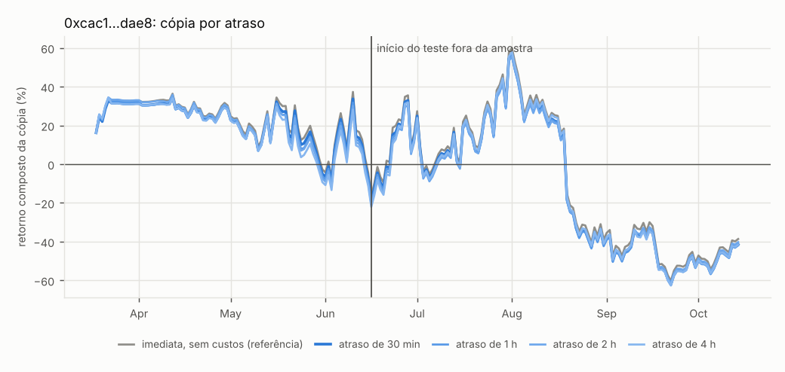
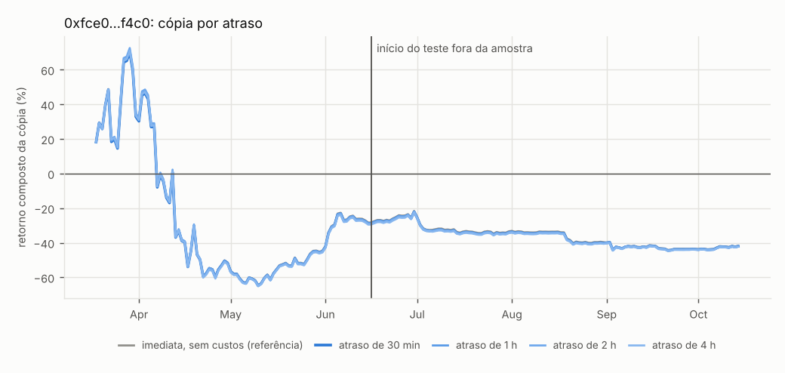
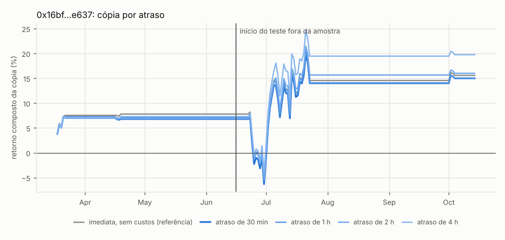
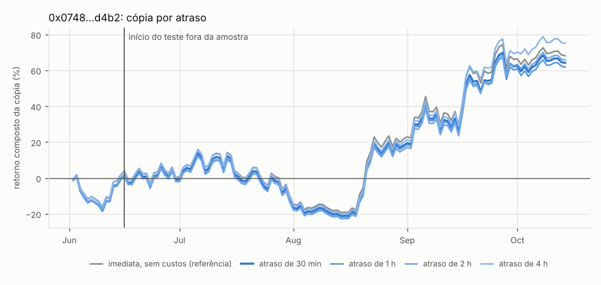
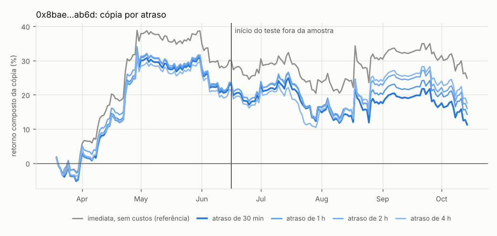
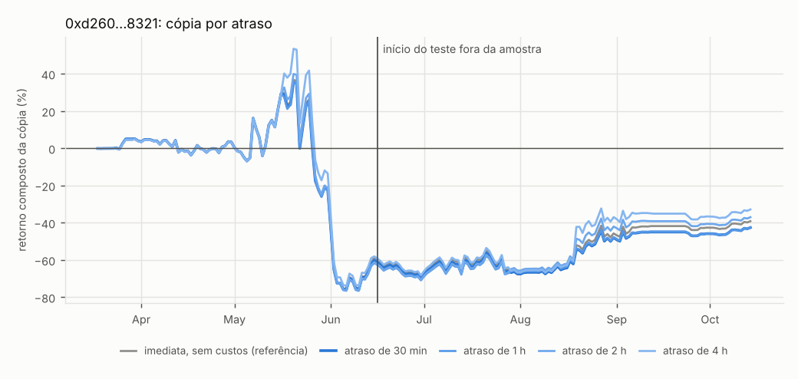
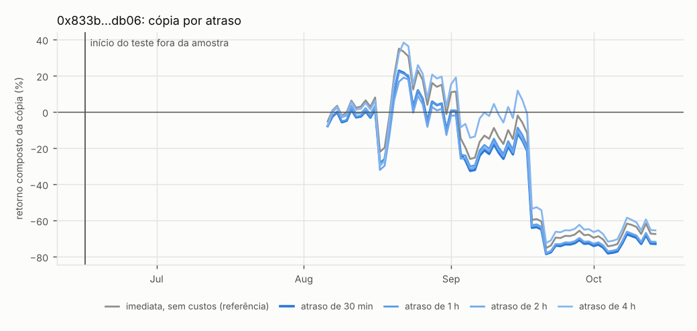
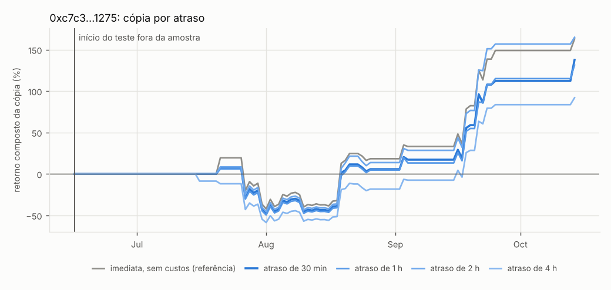
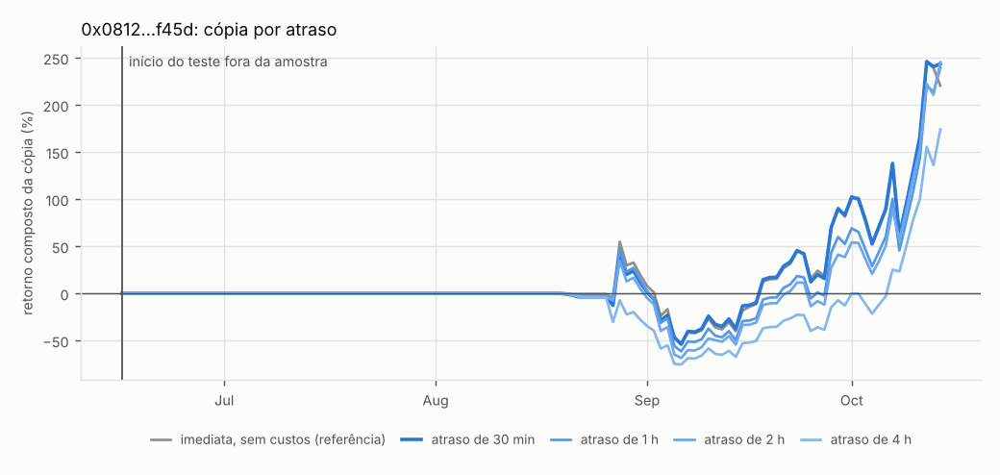

# Carteiras avulsas

> **Aviso (15/10/2026): relatório inválido.** Gerado com um código que tinha um erro na paginação dos fills (as posições ficavam congeladas por semanas na simulação) e sem as fatias de TWAP e as dex HIP-3. Os números abaixo não valem; o arquivo fica só como registro. Veja [`PROGRESSO.md`](../../PROGRESSO.md).

Cópia simulada de 16/06/2026 a 14/10/2026, com custos. Cada carteira é um teste isolado (sem seleção), então o q aqui é só sobre as carteiras desta lista.

### [0xcac1…dae8](https://app.hyperliquid.xyz/explorer/address/0xcac1f1c3e4599e044dc2a9d38a9b6ef1af1bdae8) — dados insuficientes

`0xcac1f1c3e4599e044dc2a9d38a9b6ef1af1bdae8`

| atraso | dias | retorno a.a. | Sharpe a.a. | t (HAC) | queda máx. | PnL (escala da carteira) | taxas+spread | funding |
|---|---|---|---|---|---|---|---|---|
| imediata, sem custos | 121 | -8% | -0,0 | -0,03 | -75% | −US$ 52 mil | US$ 0 | +US$ 89 mil |
| 30 min | 121 | -11% | -0,1 | -0,04 | -76% | −US$ 71 mil | −US$ 13 mil | +US$ 89 mil |
| 1 h | 121 | -10% | -0,1 | -0,04 | -76% | −US$ 66 mil | −US$ 13 mil | +US$ 89 mil |
| 2 h | 121 | +1% | 0,0 | 0,00 | -75% | −US$ 26 mil | −US$ 13 mil | +US$ 89 mil |
| 4 h | 121 | +1% | 0,0 | 0,01 | -76% | −US$ 41 mil | −US$ 13 mil | +US$ 89 mil |

- **Teste fora da amostra** (16/06/2026 → hoje, cópia com 30 min, atraso efetivo médio de 34 min; posicionada em 121 dias): p = 1,0000, q (BH) = 1,000; intervalo de 90% do retorno a.a. (bootstrap em blocos): -463% a +392%.
- **É habilidade ou mercado?** Teste de deslocamento (mesmas posições em outras datas): p = 0,037. Regressão no BTC: beta -2,82, t do alfa 1,35.
- **Estilo:** 7 entradas em 4 moedas, posição média de 34,4 dias, 3% da exposição comprada, posicionado 100% do tempo; alavancagem média 3,0x (máx. 5,0x).
- **Concentração:** PnL total negativo; sem os 5 melhores dias, −US$ 878 mil.
- **Por moeda (cópia de 30 min, janela inteira):** HYPE −US$ 501 mil, BTC +US$ 433 mil, ASTER +US$ 25 mil, xyz:BRENTOIL −US$ 12 mil, WLFI +US$ 956, xyz:SPCX +US$ 394.
- **Agora:** patrimônio em perps +US$ 392 mil; último fill em 07/10/2026; posições abertas: BTC +3.5, HYPE -31000.
- **Pendências:** poucas entradas fora da amostra (7).

### [0xfce0…f4c0](https://app.hyperliquid.xyz/explorer/address/0xfce053a5e461683454bf37ad66d20344c0e3f4c0) — dados insuficientes

`0xfce053a5e461683454bf37ad66d20344c0e3f4c0`

| atraso | dias | retorno a.a. | Sharpe a.a. | t (HAC) | queda máx. | PnL (escala da carteira) | taxas+spread | funding |
|---|---|---|---|---|---|---|---|---|
| imediata, sem custos | 121 | -58% | -2,1 | -1,22 | -29% | −US$ 849 mil | US$ 0 | +US$ 60 mil |
| 30 min | 121 | -58% | -2,0 | -1,21 | -29% | −US$ 837 mil | −US$ 16 mil | +US$ 60 mil |
| 1 h | 121 | -58% | -2,1 | -1,21 | -29% | −US$ 847 mil | −US$ 16 mil | +US$ 60 mil |
| 2 h | 121 | -57% | -2,0 | -1,20 | -29% | −US$ 833 mil | −US$ 16 mil | +US$ 60 mil |
| 4 h | 121 | -56% | -2,0 | -1,17 | -29% | −US$ 814 mil | −US$ 16 mil | +US$ 61 mil |

- **Teste fora da amostra** (16/06/2026 → hoje, cópia com 30 min, atraso efetivo médio de 33 min; posicionada em 121 dias): p = 1,0000, q (BH) = 1,000; intervalo de 90% do retorno a.a. (bootstrap em blocos): -140% a +17%.
- **É habilidade ou mercado?** Teste de deslocamento (mesmas posições em outras datas): p = 0,740. Regressão no BTC: beta -0,59, t do alfa -0,58.
- **Estilo:** 4 entradas em 3 moedas, posição média de 35,4 dias, 0% da exposição comprada, posicionado 100% do tempo; alavancagem média 0,5x (máx. 2,0x).
- **Concentração:** PnL total negativo; sem os 5 melhores dias, −US$ 1,46M.
- **Por moeda (cópia de 30 min, janela inteira):** BTC +US$ 658 mil, ETH +US$ 621 mil, xyz:XYZ100 −US$ 129 mil, xyz:SP500 −US$ 73 mil, MEGA −US$ 14 mil, xyz:SNDK +US$ 6 mil.
- **Agora:** patrimônio em perps +US$ 333 mil; último fill em 24/09/2026; posições abertas: ETH -622.4.
- **Pendências:** poucas entradas fora da amostra (4).

### [0x16bf…e637](https://app.hyperliquid.xyz/explorer/address/0x16bf84af3f85f8c8a97597bf2be549dfe0dee637) — dados insuficientes

`0x16bf84af3f85f8c8a97597bf2be549dfe0dee637`

| atraso | dias | retorno a.a. | Sharpe a.a. | t (HAC) | queda máx. | PnL (escala da carteira) | taxas+spread | funding |
|---|---|---|---|---|---|---|---|---|
| imediata, sem custos | 121 | +26% | 0,8 | 0,50 | -13% | +US$ 575 mil | US$ 0 | −US$ 88 mil |
| 30 min | 121 | +27% | 0,9 | 0,52 | -12% | +US$ 604 mil | −US$ 29 mil | −US$ 88 mil |
| 1 h | 121 | +26% | 0,8 | 0,52 | -12% | +US$ 582 mil | −US$ 29 mil | −US$ 88 mil |
| 2 h | 121 | +30% | 0,9 | 0,58 | -12% | +US$ 638 mil | −US$ 29 mil | −US$ 89 mil |
| 4 h | 121 | +38% | 1,2 | 0,73 | -11% | +US$ 813 mil | −US$ 29 mil | −US$ 89 mil |

- **Teste fora da amostra** (16/06/2026 → hoje, cópia com 30 min, atraso efetivo médio de 33 min; posicionada em 34 dias): p = 1,0000, q (BH) = 1,000; intervalo de 90% do retorno a.a. (bootstrap em blocos): -48% a +112%.
- **É habilidade ou mercado?** Teste de deslocamento (mesmas posições em outras datas): p = 0,522. Regressão no BTC: beta 0,35, t do alfa 0,03.
- **Estilo:** 2 entradas em 1 moedas, posição média de 16,2 dias, 98% da exposição comprada, posicionado 27% do tempo; alavancagem média 0,5x (máx. 2,5x).
- **Concentração:** os 5 melhores dias somam 291% do PnL; sem eles, −US$ 1,15M.
- **Por moeda (cópia de 30 min, janela inteira):** BTC +US$ 1,16M, xyz:SP500 −US$ 39 mil.
- **Agora:** patrimônio em perps US$ 0; último fill em 04/10/2026; posições abertas: nenhuma.
- **Pendências:** posicionada em poucos dias do teste (34).

### [0x0748…d4b2](https://app.hyperliquid.xyz/explorer/address/0x0748e296e5a350ec36c8487a1cea406e1b57d4b2) — reprovada

`0x0748e296e5a350ec36c8487a1cea406e1b57d4b2`

| atraso | dias | retorno a.a. | Sharpe a.a. | t (HAC) | queda máx. | PnL (escala da carteira) | taxas+spread | funding |
|---|---|---|---|---|---|---|---|---|
| imediata, sem custos | 121 | +180% | 2,3 | 1,31 | -30% | +US$ 3,31M | US$ 0 | −US$ 213 mil |
| 30 min | 121 | +179% | 2,3 | 1,31 | -31% | +US$ 3,30M | −US$ 102 mil | −US$ 213 mil |
| 1 h | 121 | +177% | 2,3 | 1,29 | -31% | +US$ 3,27M | −US$ 102 mil | −US$ 213 mil |
| 2 h | 121 | +182% | 2,4 | 1,33 | -31% | +US$ 3,37M | −US$ 102 mil | −US$ 213 mil |
| 4 h | 121 | +193% | 2,5 | 1,40 | -31% | +US$ 3,55M | −US$ 102 mil | −US$ 213 mil |

- **Teste fora da amostra** (16/06/2026 → hoje, cópia com 30 min, atraso efetivo médio de 33 min; posicionada em 121 dias): p = 0,0960, q (BH) = 0,295; intervalo de 90% do retorno a.a. (bootstrap em blocos): -45% a +423%.
- **É habilidade ou mercado?** Teste de deslocamento (mesmas posições em outras datas): p = 0,737. Regressão no BTC: beta 1,13, t do alfa 0,94.
- **Estilo:** 47 entradas em 29 moedas, posição média de 37,5 dias, 75% da exposição comprada, posicionado 100% do tempo; alavancagem média 2,1x (máx. 2,9x).
- **Concentração:** os 5 melhores dias somam 89% do PnL; sem eles, +US$ 379 mil.
- **Por moeda (cópia de 30 min, janela inteira):** AAVE +US$ 1,45M, ZEC +US$ 743 mil, BTC +US$ 568 mil, UNI +US$ 454 mil, LDO −US$ 436 mil, ZRO +US$ 373 mil.
- **Agora:** patrimônio em perps +US$ 944 mil; último fill em 12/10/2026; posições abertas: INJ -50000, SUI -431250, XRP -300000, AAVE +5000, ZRO +500000, ADA -5e+06, JUP +3e+06, XLM -3.0005e+06.
- **Pendências:** não significativo após correção para múltiplos testes (q = 0,29); lucro explicado pela direção do mercado (sem timing nem alfa sobre o BTC).

### [0x8bae…ab6d](https://app.hyperliquid.xyz/explorer/address/0x8bae3527e5a33fa0cf184f37bc112d071463ab6d) — reprovada

`0x8bae3527e5a33fa0cf184f37bc112d071463ab6d`

| atraso | dias | retorno a.a. | Sharpe a.a. | t (HAC) | queda máx. | PnL (escala da carteira) | taxas+spread | funding |
|---|---|---|---|---|---|---|---|---|
| imediata, sem custos | 121 | -9% | -0,3 | -0,25 | -9% | −US$ 170 mil | US$ 0 | −US$ 64 mil |
| 30 min | 121 | -26% | -0,9 | -0,74 | -11% | −US$ 413 mil | −US$ 160 mil | −US$ 63 mil |
| 1 h | 121 | -19% | -0,7 | -0,54 | -11% | −US$ 307 mil | −US$ 159 mil | −US$ 63 mil |
| 2 h | 121 | -15% | -0,5 | -0,37 | -11% | −US$ 245 mil | −US$ 160 mil | −US$ 63 mil |
| 4 h | 121 | -6% | -0,2 | -0,14 | -10% | −US$ 136 mil | −US$ 159 mil | −US$ 63 mil |

- **Teste fora da amostra** (16/06/2026 → hoje, cópia com 30 min, atraso efetivo médio de 49 min; posicionada em 121 dias): p = 0,7706, q (BH) = 1,000; intervalo de 90% do retorno a.a. (bootstrap em blocos): -88% a +39%.
- **É habilidade ou mercado?** Teste de deslocamento (mesmas posições em outras datas): p = 0,623. Regressão no BTC: beta 0,12, t do alfa -1,02.
- **Estilo:** 47 entradas em 34 moedas, posição média de 15,6 dias, 86% da exposição comprada, posicionado 100% do tempo; alavancagem média 1,3x (máx. 2,2x).
- **Concentração:** PnL total negativo; sem os 5 melhores dias, −US$ 1,42M.
- **Por moeda (cópia de 30 min, janela inteira):** cash:INTC +US$ 1,12M, TNSR −US$ 394 mil, xyz:AAPL −US$ 208 mil, cash:META +US$ 207 mil, xyz:SKHX +US$ 206 mil, xyz:SKHY +US$ 190 mil.
- **Agora:** patrimônio em perps +US$ 186 mil; último fill em 13/10/2026; posições abertas: BTC -10.7469, DOGE +9.75694e+06, BSV +552.51, TNSR +862794, kNEIRO +365309.
- **Pendências:** cópia com 30 min perde dinheiro fora da amostra; com 60 min de atraso perde dinheiro; com 120 min de atraso perde dinheiro; não significativo após correção para múltiplos testes (q = 1,00); lucro explicado pela direção do mercado (sem timing nem alfa sobre o BTC); lucro depende dos 5 melhores dias.

### [0xd260…8321](https://app.hyperliquid.xyz/explorer/address/0xd260b2216b735277da6771564a01c04856e78321) — reprovada

`0xd260b2216b735277da6771564a01c04856e78321`

| atraso | dias | retorno a.a. | Sharpe a.a. | t (HAC) | queda máx. | PnL (escala da carteira) | taxas+spread | funding |
|---|---|---|---|---|---|---|---|---|
| imediata, sem custos | 121 | +161% | 1,7 | 1,26 | -25% | +US$ 4,08M | US$ 0 | −US$ 306 mil |
| 30 min | 121 | +154% | 1,6 | 1,19 | -26% | +US$ 3,90M | −US$ 155 mil | −US$ 306 mil |
| 1 h | 121 | +165% | 1,7 | 1,32 | -24% | +US$ 3,93M | −US$ 155 mil | −US$ 304 mil |
| 2 h | 121 | +195% | 1,9 | 1,41 | -24% | +US$ 4,31M | −US$ 155 mil | −US$ 303 mil |
| 4 h | 121 | +207% | 1,7 | 1,12 | -28% | +US$ 4,42M | −US$ 156 mil | −US$ 302 mil |

- **Teste fora da amostra** (16/06/2026 → hoje, cópia com 30 min, atraso efetivo médio de 33 min; posicionada em 121 dias): p = 0,1179, q (BH) = 0,295; intervalo de 90% do retorno a.a. (bootstrap em blocos): -68% a +396%.
- **É habilidade ou mercado?** Teste de deslocamento (mesmas posições em outras datas): p = 0,412. Regressão no BTC: beta 1,41, t do alfa 0,52.
- **Estilo:** 18 entradas em 8 moedas, posição média de 12,1 dias, 89% da exposição comprada, posicionado 88% do tempo; alavancagem média 2,3x (máx. 7,2x).
- **Concentração:** os 5 melhores dias somam 129% do PnL; sem eles, −US$ 1,14M.
- **Por moeda (cópia de 30 min, janela inteira):** BTC −US$ 4,72M, HYPE +US$ 4,05M, ETH +US$ 1,39M, SOL +US$ 1,19M, XRP −US$ 73 mil, TAO −US$ 20 mil.
- **Agora:** patrimônio em perps +US$ 1,74M; último fill em 02/10/2026; posições abertas: SOL -45422.8.
- **Pendências:** não significativo após correção para múltiplos testes (q = 0,29); lucro explicado pela direção do mercado (sem timing nem alfa sobre o BTC); lucro depende dos 5 melhores dias.

### [0x833b…db06](https://app.hyperliquid.xyz/explorer/address/0x833b99b27dac651d02080f5e220e929df891db06) — reprovada

`0x833b99b27dac651d02080f5e220e929df891db06`

| atraso | dias | retorno a.a. | Sharpe a.a. | t (HAC) | queda máx. | PnL (escala da carteira) | taxas+spread | funding |
|---|---|---|---|---|---|---|---|---|
| imediata, sem custos | 70 | -242% | -1,0 | -0,45 | -82% | −US$ 380 mil | US$ 0 | +US$ 153 mil |
| 30 min | 70 | -329% | -1,4 | -0,61 | -82% | −US$ 511 mil | −US$ 121 mil | +US$ 152 mil |
| 1 h | 70 | -308% | -1,3 | -0,58 | -82% | −US$ 478 mil | −US$ 121 mil | +US$ 152 mil |
| 2 h | 70 | -295% | -1,2 | -0,55 | -82% | −US$ 448 mil | −US$ 121 mil | +US$ 151 mil |
| 4 h | 70 | -183% | -0,7 | -0,33 | -80% | −US$ 336 mil | −US$ 121 mil | +US$ 150 mil |

- **Teste fora da amostra** (06/08/2026 → hoje, cópia com 30 min, atraso efetivo médio de 35 min; posicionada em 70 dias): p = 0,7283, q (BH) = 1,000; intervalo de 90% do retorno a.a. (bootstrap em blocos): -1195% a +469%.
- **É habilidade ou mercado?** Teste de deslocamento (mesmas posições em outras datas): p = 0,019. Regressão no BTC: beta -2,65, t do alfa 0,11.
- **Estilo:** 15 entradas em 9 moedas, posição média de 14,2 dias, 19% da exposição comprada, posicionado 100% do tempo; alavancagem média 7,6x (máx. 20,0x).
- **Concentração:** PnL total negativo; sem os 5 melhores dias, −US$ 1,46M.
- **Por moeda (cópia de 30 min, janela inteira):** XMR −US$ 226 mil, xyz:CL −US$ 189 mil, BTC −US$ 102 mil, xyz:SP500 −US$ 56 mil, ADA +US$ 39 mil, xyz:SNDK +US$ 21 mil.
- **Agora:** patrimônio em perps +US$ 691 mil; último fill em 13/10/2026; posições abertas: BTC -47.8033, XMR -2498.86.
- **Pendências:** cópia com 30 min perde dinheiro fora da amostra; com 60 min de atraso perde dinheiro; com 120 min de atraso perde dinheiro; não significativo após correção para múltiplos testes (q = 1,00); lucro depende dos 5 melhores dias.

### [0x78dc…629c](https://app.hyperliquid.xyz/explorer/address/0x78dce96236804d6958bf3c4598cf5efbc371629c) — dados insuficientes

`0x78dce96236804d6958bf3c4598cf5efbc371629c`

- **Sem teste:** período fora da amostra curto (6 dias, fills só desde 08/10/2026).

### [0xc7c3…1275](https://app.hyperliquid.xyz/explorer/address/0xc7c37b0c7af5af560bf31b0bcbfec04b97361275) — reprovada

`0xc7c37b0c7af5af560bf31b0bcbfec04b97361275`

| atraso | dias | retorno a.a. | Sharpe a.a. | t (HAC) | queda máx. | PnL (escala da carteira) | taxas+spread | funding |
|---|---|---|---|---|---|---|---|---|
| imediata, sem custos | 121 | +436% | 2,4 | 1,39 | -52% | +US$ 18 mil | US$ 0 | −US$ 107 |
| 30 min | 121 | +401% | 2,3 | 1,30 | -51% | +US$ 18 mil | −US$ 1 mil | −US$ 112 |
| 1 h | 121 | +393% | 2,2 | 1,26 | -52% | +US$ 17 mil | −US$ 1 mil | −US$ 113 |
| 2 h | 121 | +435% | 2,4 | 1,34 | -50% | +US$ 19 mil | −US$ 1 mil | −US$ 118 |
| 4 h | 121 | +345% | 1,9 | 1,07 | -59% | +US$ 18 mil | −US$ 1 mil | −US$ 128 |

- **Teste fora da amostra** (16/06/2026 → hoje, cópia com 30 min, atraso efetivo médio de 37 min; posicionada em 45 dias): p = 0,0972, q (BH) = 0,295; intervalo de 90% do retorno a.a. (bootstrap em blocos): -69% a +928%.
- **É habilidade ou mercado?** Teste de deslocamento (mesmas posições em outras datas): p = 0,216. Regressão no BTC: beta 2,62, t do alfa 1,04.
- **Estilo:** 13 entradas em 5 moedas, posição média de 3,6 dias, 81% da exposição comprada, posicionado 32% do tempo; alavancagem média 3,4x (máx. 12,1x).
- **Concentração:** os 5 melhores dias somam 96% do PnL; sem eles, +US$ 813.
- **Por moeda (cópia de 30 min, janela inteira):** BTC +US$ 13 mil, ETH +US$ 5 mil, xyz:CXMT −US$ 679, ONDO +US$ 672, xyz:GOLD +US$ 21.
- **Agora:** patrimônio em perps +US$ 16 mil; último fill em 14/10/2026; posições abertas: BTC -2.99492, ETH +99.7964.
- **Pendências:** não significativo após correção para múltiplos testes (q = 0,29); lucro explicado pela direção do mercado (sem timing nem alfa sobre o BTC).

### [0x0812…f45d](https://app.hyperliquid.xyz/explorer/address/0x0812f31ccf62c48e6da3da3fbf98663779e1f45d) — promissora

`0x0812f31ccf62c48e6da3da3fbf98663779e1f45d`

| atraso | dias | retorno a.a. | Sharpe a.a. | t (HAC) | queda máx. | PnL (escala da carteira) | taxas+spread | funding |
|---|---|---|---|---|---|---|---|---|
| imediata, sem custos | 121 | +598% | 2,6 | 1,62 | -71% | +US$ 54 mil | US$ 0 | +US$ 1 mil |
| 30 min | 121 | +614% | 2,7 | 1,67 | -68% | +US$ 58 mil | −US$ 6 mil | +US$ 1 mil |
| 1 h | 121 | +612% | 2,7 | 1,55 | -74% | +US$ 66 mil | −US$ 6 mil | +US$ 1 mil |
| 2 h | 121 | +616% | 2,8 | 1,51 | -77% | +US$ 70 mil | −US$ 6 mil | +US$ 1 mil |
| 4 h | 121 | +542% | 2,5 | 1,32 | -75% | +US$ 76 mil | −US$ 6 mil | +US$ 1 mil |

- **Teste fora da amostra** (16/06/2026 → hoje, cópia com 30 min, atraso efetivo médio de 33 min; posicionada em 53 dias): p = 0,0486, q (BH) = 0,295; intervalo de 90% do retorno a.a. (bootstrap em blocos): +54% a +1233%.
- **É habilidade ou mercado?** Teste de deslocamento (mesmas posições em outras datas): p = 0,006. Regressão no BTC: beta -1,26, t do alfa 1,90.
- **Estilo:** 55 entradas em 15 moedas, posição média de 2,9 dias, 17% da exposição comprada, posicionado 40% do tempo; alavancagem média 4,5x (máx. 20,0x).
- **Concentração:** os 5 melhores dias somam 96% do PnL; sem eles, +US$ 2 mil.
- **Por moeda (cópia de 30 min, janela inteira):** BTC +US$ 20 mil, NEAR +US$ 15 mil, ETH +US$ 12 mil, LTC +US$ 4 mil, ARB +US$ 4 mil, FARTCOIN +US$ 4 mil.
- **Agora:** patrimônio em perps +US$ 19 mil; último fill em 14/10/2026; posições abertas: BTC +2.5, ETH +55, PONS +20000.
- **Pendências:** não significativo após correção para múltiplos testes (q = 0,29).
