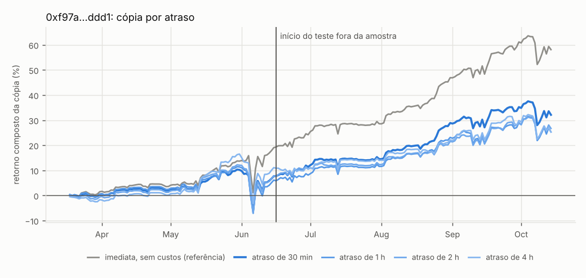
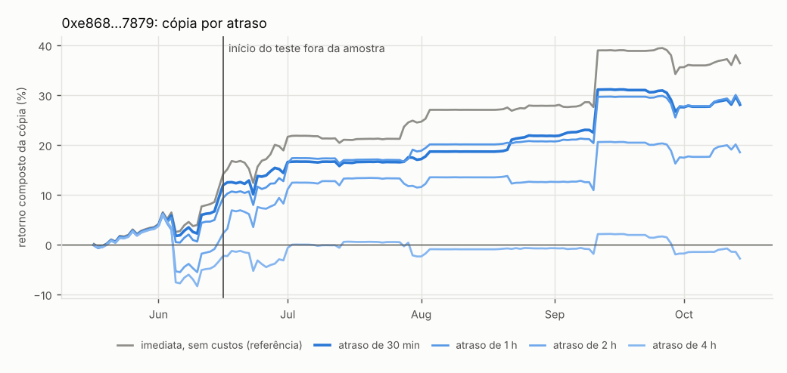
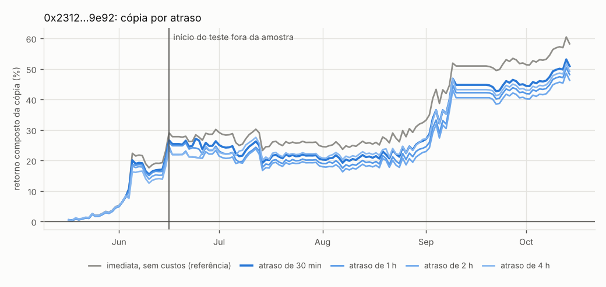
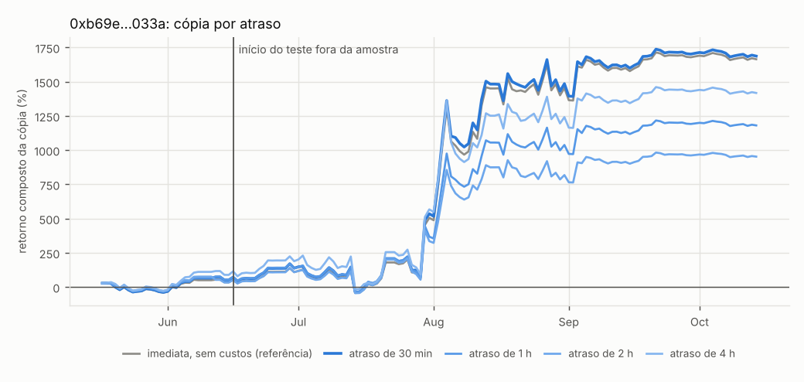
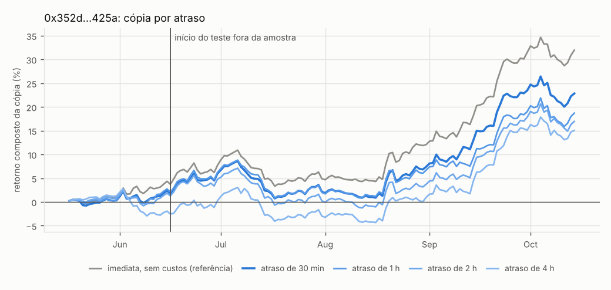

# Varredura de 14/10/2026: carteiras copiáveis com atraso

Carteiras da Hyperliquid cuja estratégia em perps **continua lucrativa quando copiada com pelo menos 30 minutos de atraso**, depois de taxas, spread e funding, num período que **não** foi usado para escolhê-las. O método está no [README](../../README.md#método).

## Resumo

- **Corte:** a seleção usou só dados até **16/06/2026**; o teste da cópia vai de 16/06/2026 a 14/10/2026 (121 dias).
- **Funil:** 47.188 carteiras no leaderboard → 7.147 com volume ≥ US$ 100M → 7.147 com histórico baixado → 1.966 pontuáveis antes do corte → 1.125 com retorno semanal positivo → **150 simuladas** (as de maior t semanal antes do corte) → **118 na família do teste final** (as que não perdiam dinheiro copiando com 30 min nos 30 dias antes do corte).
- **Resultado:** 5 promissoras, 79 reprovadas, 66 com dados insuficientes.
- **Conclusão:** nenhuma carteira passou. Com 118 testes na família, a correção de Benjamini-Hochberg pede um p perto de 0,0008 para a melhor; a melhor teve p = 0,0126. As 5 promissoras continuaram lucrando com atraso e custos depois do corte, mas um resultado assim aparece por acaso entre tantas carteiras. O próximo passo é acompanhá-las daqui para frente (`track`) e só considerar copiar as que mantiverem o resultado.
- **Custos do copiador:** taxa *taker* de 4,5 bp (HIP-3: 2x) mais meio spread/impacto por faixa de liquidez (1–25 bp), funding horário real nas moedas relevantes; alavancagem do copiador limitada a 20x.

Critérios para **aprovada** (todos fora da amostra, com custos): q de Benjamini-Hochberg ≤ 0,10 (sobre a família do teste final) para o retorno médio diário com 30 min de atraso; retorno positivo também com 1 h, 2 h; habilidade além da direção do mercado (teste de deslocamento p ≤ 0,10 ou alfa sobre o BTC com t ≥ 2,0); lucro positivo sem os 5 melhores dias; pelo menos 60 dias e 10 entradas no teste. **Promissora:** p < 0,05 sem correção e lucro com 30 e 60 min, mas falha algum outro critério.

## Carteiras aprovadas e promissoras

| carteira | veredito | retorno a.a. 30 min | 1 h | 2 h | Sharpe | t | q | deslocamento p | alfa t | queda máx. | alav. | entradas | dias/posição | moedas principais |
|---|---|---|---|---|---|---|---|---|---|---|---|---|---|---|
| [0xf97a…ddd1](#0xf97ad6704baec104d00b88e0c157e2b7b3a1ddd1) | promissora | +64% | +52% | +51% | 3,2 | 2,27 | 0,877 | 0,099 | 1,63 | -7% | 0,3x | 290 | 1,7 | HYPE, xyz:CL, xyz:SNDK, BTC |
| [0xe868…7879](#0xe8681168f59af16c60c805dab7842eb75f127879) | promissora | +49% | +56% | +52% | 2,9 | 1,95 | 0,877 | 0,038 | 1,83 | -3% | 0,2x | 245 | 1,5 | BTC, xyz:SPCX, xyz:SNDK, ETH |
| [0x2312…9e92](#0x2312171890250347dbf1b082bdf7950504909e92) | promissora | +70% | +66% | +65% | 2,8 | 1,91 | 0,877 | 0,000 | 2,10 | -6% | 0,7x | 99 | 5,0 | ZEC, WLD, HYPE, UNI |
| [0xb69e…033a](#0xb69eec8fea0081343c3b09e652ba1fa7dcf7033a) | promissora | +1533% | +1415% | +1429% | 3,1 | 1,87 | 0,877 | 0,000 | 1,97 | -76% | 3,8x | 44 | 6,9 | xyz:DRAM, BTC, xyz:NBIS, xyz:SKHX |
| [0x352d…425a](#0x352deb23bebae8b4c57d0ae341d9c1951fd8425a) | promissora | +56% | +45% | +43% | 3,6 | 1,80 | 0,877 | 0,014 | 1,58 | -7% | 0,5x | 95 | 2,9 | BTC, AAVE, UNI, TON |

Retornos anualizados sobre o patrimônio da carteira (copiar na mesma proporção do patrimônio dela), soma simples dos retornos diários × 365. Valores altos em janelas de 4 meses têm intervalos largos: veja o intervalo de bootstrap em cada ficha.

## Fichas

### [0xf97a…ddd1](https://app.hyperliquid.xyz/explorer/address/0xf97ad6704baec104d00b88e0c157e2b7b3a1ddd1) — promissora

`0xf97ad6704baec104d00b88e0c157e2b7b3a1ddd1`

| atraso | dias | retorno a.a. | Sharpe a.a. | t (HAC) | queda máx. | PnL (escala da carteira) | taxas+spread | funding |
|---|---|---|---|---|---|---|---|---|
| imediata, sem custos | 121 | +88% | 4,4 | 3,14 | -7% | +US$ 223 mil | US$ 0 | −US$ 7 mil |
| 30 min | 121 | +64% | 3,2 | 2,27 | -7% | +US$ 164 mil | −US$ 43 mil | −US$ 7 mil |
| 1 h | 121 | +52% | 2,5 | 1,85 | -7% | +US$ 134 mil | −US$ 43 mil | −US$ 7 mil |
| 2 h | 121 | +51% | 2,6 | 1,94 | -7% | +US$ 129 mil | −US$ 43 mil | −US$ 7 mil |
| 4 h | 121 | +38% | 1,9 | 1,35 | -7% | +US$ 102 mil | −US$ 43 mil | −US$ 7 mil |

- **Teste fora da amostra** (16/06/2026 → hoje, cópia com 30 min, atraso efetivo médio de 40 min; posicionada em 121 dias): p = 0,0126, q (BH) = 0,877; intervalo de 90% do retorno a.a. (bootstrap em blocos): +17% a +109%.
- **É habilidade ou mercado?** Teste de deslocamento (mesmas posições em outras datas): p = 0,099. Regressão no BTC: beta 0,22, t do alfa 1,63.
- **Estilo:** 290 entradas em 40 moedas, posição média de 1,7 dias, 99% da exposição comprada, posicionado 98% do tempo; alavancagem média 0,3x (máx. 2,1x).
- **Concentração:** os 5 melhores dias somam 57% do PnL; sem eles, +US$ 71 mil.
- **Por moeda (cópia de 30 min, janela inteira):** HYPE +US$ 83 mil, xyz:CL +US$ 54 mil, xyz:SNDK +US$ 29 mil, BTC +US$ 24 mil, ETH +US$ 20 mil, xyz:SKHX +US$ 12 mil.
- **Agora:** patrimônio em perps +US$ 359 mil; último fill em 14/10/2026; posições abertas: ETH +15, HYPE +6000, ZEC +30.
- **Pendências:** não significativo após correção para múltiplos testes (q = 0,88).

### [0xe868…7879](https://app.hyperliquid.xyz/explorer/address/0xe8681168f59af16c60c805dab7842eb75f127879) — promissora

`0xe8681168f59af16c60c805dab7842eb75f127879`

| atraso | dias | retorno a.a. | Sharpe a.a. | t (HAC) | queda máx. | PnL (escala da carteira) | taxas+spread | funding |
|---|---|---|---|---|---|---|---|---|
| imediata, sem custos | 121 | +63% | 3,1 | 1,93 | -4% | +US$ 21 mil | US$ 0 | −US$ 464 |
| 30 min | 121 | +49% | 2,9 | 1,95 | -3% | +US$ 17 mil | −US$ 5 mil | −US$ 462 |
| 1 h | 121 | +56% | 3,0 | 2,05 | -3% | +US$ 19 mil | −US$ 5 mil | −US$ 461 |
| 2 h | 121 | +52% | 2,5 | 1,61 | -4% | +US$ 17 mil | −US$ 5 mil | −US$ 452 |
| 4 h | 121 | +3% | 0,2 | 0,12 | -5% | +US$ 1 mil | −US$ 5 mil | −US$ 438 |

- **Teste fora da amostra** (16/06/2026 → hoje, cópia com 30 min, atraso efetivo médio de 37 min; posicionada em 121 dias): p = 0,0268, q (BH) = 0,877; intervalo de 90% do retorno a.a. (bootstrap em blocos): +12% a +90%.
- **É habilidade ou mercado?** Teste de deslocamento (mesmas posições em outras datas): p = 0,038. Regressão no BTC: beta 0,03, t do alfa 1,83.
- **Estilo:** 245 entradas em 24 moedas, posição média de 1,5 dias, 100% da exposição comprada, posicionado 90% do tempo; alavancagem média 0,2x (máx. 1,7x).
- **Concentração:** os 5 melhores dias somam 99% do PnL; sem eles, +US$ 119.
- **Por moeda (cópia de 30 min, janela inteira):** BTC +US$ 5 mil, xyz:SPCX +US$ 4 mil, xyz:SNDK +US$ 3 mil, ETH +US$ 3 mil, xyz:MU +US$ 3 mil, xyz:MRVL +US$ 2 mil.
- **Agora:** patrimônio em perps +US$ 60 mil; último fill em 14/10/2026; posições abertas: BTC +0.09009, ETH +2.6928, NEAR +162.6, HYPE +308.72, ZEC +4, LIT +4371.
- **Pendências:** não significativo após correção para múltiplos testes (q = 0,88).

### [0x2312…9e92](https://app.hyperliquid.xyz/explorer/address/0x2312171890250347dbf1b082bdf7950504909e92) — promissora

`0x2312171890250347dbf1b082bdf7950504909e92`

| atraso | dias | retorno a.a. | Sharpe a.a. | t (HAC) | queda máx. | PnL (escala da carteira) | taxas+spread | funding |
|---|---|---|---|---|---|---|---|---|
| imediata, sem custos | 121 | +78% | 3,2 | 2,22 | -5% | +US$ 160 mil | US$ 0 | −US$ 462 |
| 30 min | 121 | +70% | 2,8 | 1,91 | -6% | +US$ 144 mil | −US$ 21 mil | −US$ 483 |
| 1 h | 121 | +66% | 2,6 | 1,77 | -7% | +US$ 137 mil | −US$ 22 mil | −US$ 466 |
| 2 h | 121 | +65% | 2,5 | 1,74 | -7% | +US$ 135 mil | −US$ 21 mil | −US$ 462 |
| 4 h | 121 | +74% | 3,0 | 2,08 | -6% | +US$ 150 mil | −US$ 21 mil | −US$ 445 |

- **Teste fora da amostra** (16/06/2026 → hoje, cópia com 30 min, atraso efetivo médio de 37 min; posicionada em 119 dias): p = 0,0294, q (BH) = 0,877; intervalo de 90% do retorno a.a. (bootstrap em blocos): +7% a +141%.
- **É habilidade ou mercado?** Teste de deslocamento (mesmas posições em outras datas): p = 0,000. Regressão no BTC: beta -0,03, t do alfa 2,10.
- **Estilo:** 99 entradas em 44 moedas, posição média de 5,0 dias, 53% da exposição comprada, posicionado 86% do tempo; alavancagem média 0,7x (máx. 2,8x).
- **Concentração:** os 5 melhores dias somam 87% do PnL; sem eles, +US$ 19 mil.
- **Por moeda (cópia de 30 min, janela inteira):** ZEC +US$ 102 mil, WLD +US$ 53 mil, HYPE +US$ 48 mil, UNI +US$ 35 mil, LIT −US$ 31 mil, BTC −US$ 27 mil.
- **Agora:** patrimônio em perps +US$ 27 mil; último fill em 14/10/2026; posições abertas: OP +673581, UNI -13068.5.
- **Pendências:** não significativo após correção para múltiplos testes (q = 0,88).

### [0xb69e…033a](https://app.hyperliquid.xyz/explorer/address/0xb69eec8fea0081343c3b09e652ba1fa7dcf7033a) — promissora

`0xb69eec8fea0081343c3b09e652ba1fa7dcf7033a`

| atraso | dias | retorno a.a. | Sharpe a.a. | t (HAC) | queda máx. | PnL (escala da carteira) | taxas+spread | funding |
|---|---|---|---|---|---|---|---|---|
| imediata, sem custos | 121 | +1584% | 3,2 | 1,89 | -76% | +US$ 1,06M | US$ 0 | −US$ 9 mil |
| 30 min | 121 | +1533% | 3,1 | 1,87 | -76% | +US$ 1,01M | −US$ 57 mil | −US$ 8 mil |
| 1 h | 121 | +1415% | 3,0 | 1,89 | -76% | +US$ 928 mil | −US$ 57 mil | −US$ 8 mil |
| 2 h | 121 | +1429% | 2,9 | 1,85 | -77% | +US$ 879 mil | −US$ 57 mil | −US$ 8 mil |
| 4 h | 121 | +1392% | 3,0 | 1,80 | -75% | +US$ 904 mil | −US$ 58 mil | −US$ 7 mil |

- **Teste fora da amostra** (16/06/2026 → hoje, cópia com 30 min, atraso efetivo médio de 50 min; posicionada em 121 dias): p = 0,0316, q (BH) = 0,877; intervalo de 90% do retorno a.a. (bootstrap em blocos): +282% a +3069%.
- **É habilidade ou mercado?** Teste de deslocamento (mesmas posições em outras datas): p = 0,000. Regressão no BTC: beta 0,10, t do alfa 1,97.
- **Estilo:** 44 entradas em 21 moedas, posição média de 6,9 dias, 44% da exposição comprada, posicionado 97% do tempo; alavancagem média 3,8x (máx. 18,9x).
- **Concentração:** os 5 melhores dias somam 80% do PnL; sem eles, +US$ 202 mil.
- **Por moeda (cópia de 30 min, janela inteira):** xyz:DRAM +US$ 457 mil, BTC +US$ 430 mil, xyz:NBIS +US$ 240 mil, xyz:SKHX +US$ 154 mil, HYPE −US$ 130 mil, ETH +US$ 105 mil.
- **Agora:** patrimônio em perps +US$ 516 mil; último fill em 05/09/2026; posições abertas: BTC +70.7256, BNB +1735.13.
- **Pendências:** não significativo após correção para múltiplos testes (q = 0,88); sem ordens nos últimos 30 dias (segue com posições abertas).

### [0x352d…425a](https://app.hyperliquid.xyz/explorer/address/0x352deb23bebae8b4c57d0ae341d9c1951fd8425a) — promissora

`0x352deb23bebae8b4c57d0ae341d9c1951fd8425a`

| atraso | dias | retorno a.a. | Sharpe a.a. | t (HAC) | queda máx. | PnL (escala da carteira) | taxas+spread | funding |
|---|---|---|---|---|---|---|---|---|
| imediata, sem custos | 121 | +72% | 4,4 | 2,24 | -7% | +US$ 239 mil | US$ 0 | −US$ 3 mil |
| 30 min | 121 | +56% | 3,6 | 1,80 | -7% | +US$ 189 mil | −US$ 39 mil | −US$ 3 mil |
| 1 h | 121 | +45% | 2,9 | 1,48 | -7% | +US$ 153 mil | −US$ 39 mil | −US$ 3 mil |
| 2 h | 121 | +43% | 2,8 | 1,43 | -8% | +US$ 151 mil | −US$ 39 mil | −US$ 3 mil |
| 4 h | 121 | +49% | 3,1 | 1,54 | -7% | +US$ 172 mil | −US$ 39 mil | −US$ 3 mil |

- **Teste fora da amostra** (16/06/2026 → hoje, cópia com 30 min, atraso efetivo médio de 34 min; posicionada em 121 dias): p = 0,0372, q (BH) = 0,877; intervalo de 90% do retorno a.a. (bootstrap em blocos): +4% a +108%.
- **É habilidade ou mercado?** Teste de deslocamento (mesmas posições em outras datas): p = 0,014. Regressão no BTC: beta 0,14, t do alfa 1,58.
- **Estilo:** 95 entradas em 51 moedas, posição média de 2,9 dias, 57% da exposição comprada, posicionado 100% do tempo; alavancagem média 0,5x (máx. 0,8x).
- **Concentração:** os 5 melhores dias somam 56% do PnL; sem eles, +US$ 83 mil.
- **Por moeda (cópia de 30 min, janela inteira):** BTC +US$ 233 mil, FARTCOIN −US$ 9 mil, ZEC −US$ 8 mil, LIT −US$ 6 mil, XRP −US$ 5 mil, ONDO −US$ 4 mil.
- **Agora:** patrimônio em perps +US$ 89 mil; último fill em 14/10/2026; posições abertas: BTC -10.327, ADA +3883, ONDO +2261, SKY +13933.
- **Pendências:** não significativo após correção para múltiplos testes (q = 0,88).

## O que sobra do passado

Das 118 carteiras da família, 52 tinham dados para o teste. Se nenhuma tivesse vantagem real, o acaso daria cerca de 2,6 com p < 0,05 e 0,5 com p < 0,01, e metade teria retorno médio positivo.

| cópia | p < 0,05 | p < 0,01 | retorno médio > 0 |
|---|---|---|---|
| imediata, sem custos (o próprio trader) | 5 | 1 | 37 de 52 |
| 30 min, com custos | 5 | 0 | 36 de 52 |
| 1 h, com custos | 4 | 0 | 32 de 52 |
| 2 h, com custos | 3 | 0 | 32 de 52 |

No mesmo período o BTC variou +26%: retorno positivo sozinho pode ser só direção do mercado, por isso o teste de deslocamento e o alfa.

A linha de cima mede se o trader manteve a vantagem depois do corte; as de baixo, quanto dela sobrevive ao atraso e aos custos. Quando a linha de cima já fica perto do acaso, o problema não é o atraso: o desempenho passado das carteiras não se repetiu.

## Por que as outras não passaram

Uma carteira pode falhar em mais de um critério.

| motivo | carteiras |
|---|---|
| não significativo após correção para múltiplos testes | 46 |
| lucro depende dos 5 melhores dias | 44 |
| período fora da amostra curto | 40 |
| lucro explicado pela direção do mercado | 34 |
| cópia com 30 min já perdia dinheiro antes do corte | 32 |
| sem ordens nos últimos 30 dias | 28 |
| com 60 min de atraso perde dinheiro | 19 |
| com 120 min de atraso perde dinheiro | 19 |
| poucas entradas fora da amostra | 16 |
| cópia com 30 min perde dinheiro fora da amostra | 15 |
| posicionada em poucos dias do teste | 10 |
| sem operações em perps no período | 1 |

### As 15 melhores entre as reprovadas

| carteira | retorno a.a. 30 min | t | q | deslocamento p | alfa t | beta BTC | lucro sem 5 melhores dias | motivo |
|---|---|---|---|---|---|---|---|---|
| [0x054a…db2f](https://app.hyperliquid.xyz/explorer/address/0x054a01da80ee37d5220af5471b1eedbdcd2cdb2f) | +97% | 1,49 | – | 0,007 | 1,91 | 0,58 | +US$ 60 mil | cópia com 30 min já perdia dinheiro antes do corte (fora da família testada) |
| [0x891a…271a](https://app.hyperliquid.xyz/explorer/address/0x891a46617b6997f1d809147bb0c9d62e4af2271a) | +436% | 1,34 | – | 0,018 | 1,14 | 0,75 | −US$ 26 mil | cópia com 30 min já perdia dinheiro antes do corte (fora da família testada) |
| [0x99b1…0729](https://app.hyperliquid.xyz/explorer/address/0x99b1098d9d50aa076f78bd26ab22e6abd3710729) | +94% | 1,32 | 1,00 | 0,000 | 1,35 | 0,20 | −US$ 16 mil | não significativo após correção para múltiplos testes (q = 1,00); lucro depende dos 5 melhores dias; sem ordens nos últimos 30 dias |
| [0x0748…d4b2](https://app.hyperliquid.xyz/explorer/address/0x0748e296e5a350ec36c8487a1cea406e1b57d4b2) | +179% | 1,31 | 1,00 | 0,763 | 0,94 | 1,13 | +US$ 379 mil | não significativo após correção para múltiplos testes (q = 1,00); lucro explicado pela direção do mercado (sem timing nem alfa sobre o BTC) |
| [0x5e13…2607](https://app.hyperliquid.xyz/explorer/address/0x5e13d5cedbddd7237f659947ce64bec1294e2607) | +19% | 1,23 | 1,00 | 0,001 | 0,88 | 0,11 | −US$ 80 mil | não significativo após correção para múltiplos testes (q = 1,00); lucro depende dos 5 melhores dias |
| [0xd260…8321](https://app.hyperliquid.xyz/explorer/address/0xd260b2216b735277da6771564a01c04856e78321) | +154% | 1,19 | – | 0,416 | 0,52 | 1,41 | −US$ 1,14M | cópia com 30 min já perdia dinheiro antes do corte (fora da família testada) |
| [0xa8cb…af2d](https://app.hyperliquid.xyz/explorer/address/0xa8cbf4200595efcd94b7526d04deafe0f284af2d) | +64% | 1,17 | – | 0,197 | 0,56 | 0,60 | −US$ 24 mil | cópia com 30 min já perdia dinheiro antes do corte (fora da família testada) |
| [0xd6ef…a07a](https://app.hyperliquid.xyz/explorer/address/0xd6ef5649200101eb44ce8949f4cfb167b0c5a07a) | +15% | 1,16 | 1,00 | 0,002 | 1,20 | -0,03 | −US$ 22 mil | não significativo após correção para múltiplos testes (q = 1,00); lucro depende dos 5 melhores dias; sem ordens nos últimos 30 dias |
| [0xa5fd…15ff](https://app.hyperliquid.xyz/explorer/address/0xa5fd942d4badbab4fe84a9e10f565dd40d5f15ff) | +104% | 1,12 | – | 0,535 | 0,68 | 0,59 | −US$ 144 mil | cópia com 30 min já perdia dinheiro antes do corte (fora da família testada) |
| [0x3bbe…5b40](https://app.hyperliquid.xyz/explorer/address/0x3bbe8e02f72b10c9698a6e4375b5a19e53fc5b40) | +35% | 1,06 | – | 0,235 | 0,43 | 0,30 | −US$ 13 mil | cópia com 30 min já perdia dinheiro antes do corte (fora da família testada) |
| [0xb14d…8560](https://app.hyperliquid.xyz/explorer/address/0xb14d1598dbfeaec11bae2a382b29adfcab9e8560) | +423% | 1,04 | 1,00 | 0,304 | 0,91 | 2,32 | −US$ 177 mil | não significativo após correção para múltiplos testes (q = 1,00); lucro explicado pela direção do mercado (sem timing nem alfa sobre o BTC); lucro depende dos 5 melhores dias; sem ordens nos últimos 30 dias |
| [0xc088…2e21](https://app.hyperliquid.xyz/explorer/address/0xc08895cf0f48d7d43a602db2c2d45f52d7ae2e21) | +480% | 1,04 | – | 0,000 | 1,44 | -2,53 | −US$ 16 mil | cópia com 30 min já perdia dinheiro antes do corte (fora da família testada) |
| [0x58cb…bf00](https://app.hyperliquid.xyz/explorer/address/0x58cbd807135f66e8c9b4f39eea92a612b477bf00) | +2% | 1,02 | – | 0,937 | 1,04 | -0,00 | US$ 0 | cópia com 30 min já perdia dinheiro antes do corte (fora da família testada) |
| [0x29eb…7043](https://app.hyperliquid.xyz/explorer/address/0x29eb62882a8bd104a64400a2971d0d6881777043) | +70% | 1,00 | 1,00 | 0,334 | 0,81 | 0,55 | −US$ 17 mil | não significativo após correção para múltiplos testes (q = 1,00); lucro explicado pela direção do mercado (sem timing nem alfa sobre o BTC); lucro depende dos 5 melhores dias; sem ordens nos últimos 30 dias |
| [0x8af7…fa05](https://app.hyperliquid.xyz/explorer/address/0x8af700ba841f30e0a3fcb0ee4c4a9d223e1efa05) | +140% | 0,99 | 1,00 | 0,573 | 0,36 | 0,93 | −US$ 5,47M | não significativo após correção para múltiplos testes (q = 1,00); lucro explicado pela direção do mercado (sem timing nem alfa sobre o BTC); lucro depende dos 5 melhores dias; sem ordens nos últimos 30 dias (segue com posições abertas) |

## Arquivos

- `resultados.csv`: todas as carteiras testadas na etapa C, com as métricas e o motivo do veredito;
- `etapa_b.csv.gz`: a pontuação semanal (antes do corte) de todas as carteiras da etapa B;
- `selecao.json`: as aprovadas e promissoras, com a data, para acompanhar daqui para frente (`python -m hlwf track reports/varredura_…/selecao.json`).

## Limitações

- A cópia é simulada com velas de 5 min (Binance até ontem, validada contra o fechamento diário da Hyperliquid, e Hyperliquid nas últimas horas). Moedas sem Binance (HIP-3 e as exclusivas da Hyperliquid) usam velas de 15 min nos últimos 52 dias e de 1 h antes disso: o atraso efetivo fica maior (mais conservador).
- Spread e impacto são estimados pela liquidez de hoje, não a da época. Copiadores grandes pagam mais.
- Posições em HIP-3 abertas antes do período de fills e nunca mexidas não aparecem (o estado aberto só é lido da bolsa principal). Ordens TWAP antigas podem faltar; o salto de posição é aplicado no fill seguinte.
- Fora da amostra não quer dizer futuro: um trader pode mudar de estilo ou parar. Acompanhe com `track`.
- Nada aqui é recomendação de investimento.
